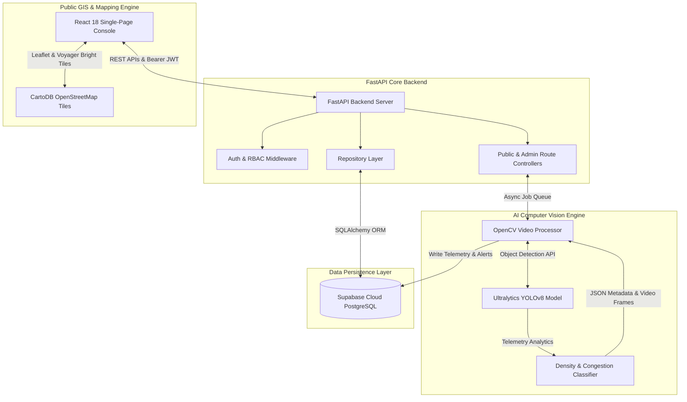

# TrafficVision AI
### AI-Powered Smart Traffic Monitoring & Congestion Management System

[](https://www.python.org/)
[](https://fastapi.tiangolo.com/)
[](https://react.dev/)
[](https://github.com/ultralytics/ultralytics)
[](https://opencv.org/)
[](https://supabase.com/)
[](https://leafletjs.com/)
[](LICENSE)

> **TrafficVision AI** is an intelligent, full-stack smart city traffic management platform that integrates direct computer vision detection with urban road infrastructure orchestration and a public transparency traffic portal. By combining state-of-the-art AI-powered vehicle detection, density estimation, and congestion classification with real-time operator management and citizen transparency, the platform automates traffic monitoring and enables rapid, data-driven incident response.

---

## 📋 Table of Contents
1. [Project Overview](#-project-overview)
2. [Problem Statement](#-problem-statement)
3. [Solution](#-solution)
4. [Key Features](#-key-features)
5. [System Architecture](#-system-architecture)
6. [AI Processing Pipeline](#-ai-processing-pipeline)
7. [Technology Stack](#-technology-stack)
8. [Database Schema](#-database-schema)
9. [Implemented Modules & Status](#-implemented-modules--status)
10. [AI Congestion Detection Mechanism](#-ai-congestion-detection-mechanism)
11. [User Experience & Persona Workflows](#-user-experience--persona-workflows)
12. [API Overview](#-api-overview)
13. [Installation & Setup](#-installation--setup)
14. [Environment Variables](#-environment-variables)
15. [Testing & E2E Audit Verification](#-testing--e2e-audit-verification)
16. [Contributors & License](#-contributors--license)

---

## 🔍 Project Overview

**TrafficVision AI** is a state-of-the-art urban mobility monitoring console designed to aid city administrators, chief traffic controllers, field operators, and public commuters. It integrates high-performance AI computer vision models to ingest live or recorded traffic video feeds, extract telemetry, classify vehicles, and automatically determine congestion levels across critical junctions and corridors.

The project implementation is structured across three fully completed milestones:
*   **Milestone 1 (Operational Control Core)**: Established the foundational web framework, robust multi-role dashboards (Admin and Operator), secure JWT authentication with Role-Based Access Control (RBAC), and cloud database persistence for managing roads, zones, operator assignments, alerts, and operational reporting.
*   **Milestone 2 (AI Computer Vision Integration)**: Introduced OpenCV-based frame extraction, Ultralytics YOLOv8 vehicle detection models, automated vehicle categorization (cars, buses, trucks, motorcycles), and real-time congestion classification. Binds computer vision telemetry to Supabase PostgreSQL to dynamically update dashboard visualizations and populate historical analytics.
*   **Milestone 3 (Public Traffic Experience & Transparency Portal)**: Delivered a public transparency portal featuring a Guest Public Traffic Dashboard, an Interactive Real Geographic Live GIS Map (Leaflet + OpenStreetMap CartoDB Voyager bright tiles with 3D color-coded markers), Public Road Details with historical snapshot timelines, Public Active Advisories with 15-second background polling, Multi-Criteria Search & Filtering with single-click Clear Filters, and a Logged-In Public User Personalized Dashboard with persistent database-backed favorite corridors (`user_favorite_roads`) and 100% user data isolation.

---

## ⚠️ Problem Statement

Rapidly expanding metropolitan areas are restricted by outdated traffic supervision systems that depend heavily on human oversight, leading to:
1.  **Manual & Fragmented Monitoring**: Operators manually watch camera feeds, missing developing bottlenecks.
2.  **Delayed Congestion Detection**: Traffic backups are identified late, causing cascading gridlock.
3.  **Lack of Centralized Operator Management**: No unified tool exists to assign controllers to specific roads.
4.  **Slow Incident Response**: Incident escalations rely on manual reporting, delaying emergency responders.
5.  **No Intelligent Congestion Analysis**: Traditional telemetry fails to categorize traffic density based on road capacity and vehicle composition.
6.  **Lack of Public Transparency**: Citizens lack visibility into real-time corridor congestion, active road advisories, and estimated daily commute delays.

---

## 💡 Solution

TrafficVision AI addresses these challenges with a unified smart city control center and citizen portal:
*   🔒 **Role-Based Access Control (RBAC)**: Secure separation between System Administrators, Field Operators, Logged-In Public Commuters, and Unauthenticated Guest Citizens.
*   📊 **Real-Time Live Monitoring**: Multi-road telemetry dashboards displaying active vehicle counts, average speeds, and congestion status indicators.
*   🛣️ **Corridor & Operator Management**: Administrative interfaces to manage road parameters, map coordinates, operators, and active duty assignments.
*   🤖 **AI-Based Vehicle Detection**: Automated computer vision processing of road cameras to count and classify passing vehicles.
*   🚦 **Automatic Congestion Detection**: Smart density scoring that triggers instant critical alerts when capacity thresholds are breached.
*   🗺️ **Real Geographic Live GIS Map**: Interactive GIS map plotting 12 monitored corridors with color-coded markers (Green, Amber, Orange, Red) and camera fly-to centering.
*   ⭐ **Personalized Commuter Dashboard**: Logged-in public users can pin favorite corridors, view data-driven route recommendations, and estimate commute delays.

---

## ✨ Key Features

### 🏢 Milestone 1: Operational Core & Governance
*   **Authentication & Security**: Secure JWT asymmetric authorization with granular RBAC (Admin / Operator).
*   **Admin Dashboard**: High-level metrics tracking active alerts, operator availability, road status, and corridor speeds.
*   **Infrastructure Management**: Full CRUD interfaces for road corridors, detailing speed limits, length, and lane counts.
*   **Zone Management**: Grouping roads into distinct geographical perimeters (e.g., Zone Alpha - Financial District) with bulk controls.
*   **Personnel & Duty Orchestration**: Onboard operators, issue auto-generated temporary credentials, and manage duty assignments.
*   **Alerts & Incidents**: System-wide alert generation with severity grading (Low, Medium, High, Critical) and resolution sign-offs.

### 🧠 Milestone 2: AI Computer Vision & Analytics
*   **Traffic Video Upload**: Dedicated upload endpoint supporting `.mp4`, `.avi`, `.mov` formats linked to specific road corridors.
*   **Video Processing Engine (OpenCV)**: Asynchronous background worker executing frame extraction, bounding box drawing, and ByteTrack ROI filtering.
*   **Object Detection & Classification (YOLOv8)**: Ultralytics YOLOv8 model trained to classify: **Cars, Buses, Trucks, and Motorcycles**.
*   **Traffic Telemetry Extraction**: Frame-by-frame vehicle counting, Passenger Car Equivalent (PCE) density scoring, and categorical congestion mapping (`LOW`, `MODERATE`, `HIGH`, `CRITICAL`).
*   **Supabase Database Auto-Updates**: Asynchronous DB handlers writing frame results directly to `traffic_data` and creating `alerts` on critical congestion spikes.

### 🌐 Milestone 3: Public Traffic Experience & Transparency Portal
*   **Guest Public Dashboard**: Unauthenticated portal displaying total monitored corridors, live speed/volume stats, low/moderate/high/critical counters, and 12-road roster grid.
*   **Real Geographic Live Traffic Map**: Interactive Leaflet GIS map rendering CartoDB Voyager bright tiles, exact database GPS coordinates, 3D color-coded markers, and map camera fly-to (`/public/map?road_id=X`).
*   **Public Road Details & Live Telemetry**: Corridor inspection panel detailing vehicle class composition (Cars, Motorcycles, Buses, Trucks) and 5 historical telemetry snapshots.
*   **Public Active Advisories**: Live AI incident warnings feed with background polling and GIS map links.
*   **Public Search & Multi-Criteria Filtering**: Multi-criteria search by road name, road code (`RD-xxx`), zone, or alert ref, paired with congestion severity and zone dropdown filters and single-click **Clear Filters**.
*   **Personalized Public User Dashboard**: Logged-in public commuter interface featuring database-backed favorite corridors (`user_favorite_roads`), 100% user data isolation, data-driven recommendations, and commute delay estimator.

---

## 🏗️ System Architecture



---

## 🛠️ Technology Stack

| Layer | Technology | Version | Purpose |
| :--- | :--- | :--- | :--- |
| **Frontend** | React | 18.x | Single Page Application UI structure |
| | Vite | 5.x | High-performance client-side bundler |
| | Tailwind CSS | 3.x | Dark glassmorphism styling & design system |
| | Leaflet & React-Leaflet | 1.9.4 / 4.2.1 | Interactive GIS map tile rendering & marker spatial controls |
| | Recharts | 2.x | Time-series telemetry charting |
| **Backend** | FastAPI | 0.110.x | High-throughput asynchronous Python web framework |
| | OpenCV | 4.x | Video stream decoding and annotated frame rendering |
| | Ultralytics YOLOv8| 8.x | Real-time object detection and vehicle classification |
| | SQLAlchemy | 2.x | Object-Relational Mapper (ORM) |
| | Pydantic | 2.x | Secure schema definitions & JSON serialization |
| **Database** | Supabase (PostgreSQL)| 15+ | Relational data persistence & spatial indexing |
| **Security** | PyJWT / Bcrypt | 2.8.x / 4.x | Secure client authorization token management & password hashing |

---

## 🗄️ Database Schema

### 🏢 Core System Tables
1. **`users`**: System profiles (Admin, Operator, Public Commuter). `id`, `name`, `email`, `password_hash`, `role`, `status`, `zone`, `shift`, `created_at`.
2. **`roads`**: Monitored corridors. `id`, `road_code`, `road_name`, `zone`, `zone_id`, `latitude`, `longitude`, `status`, `length_km`, `lanes`, `speed_limit`, `assigned_operator_id`.
3. **`zones`**: City sectors. `id`, `zone_name`, `zone_code`, `description`, `status`, `center_latitude`, `center_longitude`.
4. **`operator_road_assignments`**: Operator duty assignments. `id`, `operator_id`, `road_id`, `zone_id`, `assigned_by`, `assigned_at`, `status`.
5. **`traffic_data`**: Telemetry snapshots. `id`, `road_id`, `vehicle_count`, `car_count`, `bus_count`, `truck_count`, `motorcycle_count`, `average_speed`, `congestion_level`, `timestamp`.
6. **`alerts`**: Incident records. `id`, `road_id`, `alert_type`, `severity`, `status`, `assigned_operator_id`, `notes`, `created_at`.
7. **`uploaded_videos`**: Catalog of analyzed video feeds. `id`, `road_id`, `filename`, `filepath`, `file_size_bytes`, `status`, `uploaded_at`.
8. **`user_favorite_roads`** *(New in Milestone 3)*: Persisted public commuter corridor bookmarks. `id`, `user_id` (FK -> users), `road_id` (FK -> roads), `created_at`.

---

## 📈 Implemented Modules & Verification Status

| Milestone | Module | Features | Status | Verification |
| :--- | :--- | :--- | :---: | :--- |
| **Milestone 1** | **Authentication** | JWT secure token, RBAC for Operator/Admin | ✅ COMPLETED | E2E Integration tests passed |
| | **Dashboards** | Executive Admin stats & scoped Operator views | ✅ COMPLETED | Unit & view tests verified |
| | **Infrastructure** | Road & Zone CRUD, spatial coordinates mapping | ✅ COMPLETED | CRUD forms validated |
| | **Personnel** | Operator onboarding & road assignments | ✅ COMPLETED | Workload distribution verified |
| | **Alerts & Reports**| Incident queues, resolution inputs, PDF/CSV export | ✅ COMPLETED | File stream export validated |
| **Milestone 2** | **YOLO Ingestion** | Video directory audit, OpenCV frame extraction | ✅ COMPLETED | 12 / 12 Videos & Roads mapped |
| | **Detection** | Ultralytics YOLOv8 vehicle classification | ✅ COMPLETED | Cars, Buses, Trucks, Motorcycles verified |
| | **AI Telemetry** | PCE density calculation & congestion mapping | ✅ COMPLETED | 4,288 DB telemetry records verified |
| | **Playback Sync** | H.264 video player with $O(\log N)$ timestamp sync | ✅ COMPLETED | Sub-second sync verified |
| | **AI Incident Alert**| Automatic incident alert creation on congestion spike | ✅ COMPLETED | Alerts generated & assigned |
| **Milestone 3** | **Guest Portal** | Public dashboard stats, road roster grid, read-only API | ✅ COMPLETED | 0 login redirects verified |
| | **Geographic Map**| GIS Leaflet map, CartoDB Voyager tiles, 3D markers | ✅ COMPLETED | 12 / 12 GPS coordinates verified |
| | **Road Details** | Vehicle class breakdown & snapshot history timeline | ✅ COMPLETED | Telemetry history drawer verified |
| | **Public Alerts** | Live active advisories feed with background polling | ✅ COMPLETED | 15s live refresh verified |
| | **Search & Filter** | Multi-criteria search, congestion/zone filters, Clear Filters | ✅ COMPLETED | 10 Automated test scenarios passed |
| | **Personalization**| Favorites persistence (`user_favorite_roads`), User Isolation | ✅ COMPLETED | 100% User Isolation verified |
| | **E2E Audit** | Final E2E, Security, SLA Performance Audit | ✅ COMPLETED | 23 / 23 Audit Phases Passed (100%) |

---

## 👤 User Experience & Persona Workflows

### 1. Guest Citizen Workflow (`Unauthenticated`)
```text
Guest Citizen
    │
    ├─► /public/dashboard  (View city-wide traffic stats & road roster)
    ├─► /public/map        (Inspect interactive Leaflet GIS map with bright tiles)
    ├─► /public/roads      (Search/filter roads & view telemetry snapshots)
    └─► /public/alerts     (Check active incident advisories)
```

### 2. Logged-In Public Commuter Workflow (`PUBLIC` Role)
```text
Public Commuter
    │
    ├─► /public/dashboard  (Personalized welcome card & pinned favorite corridors)
    ├─► Favorites Control  (Star ⭐ corridor -> stored in user_favorite_roads table)
    ├─► Commute Estimator  (Select origin & destination to estimate delay)
    └─► AI Recommendations (Real telemetry recommendations: e.g. "5th Avenue HIGH, check Wall Street")
```

### 3. Traffic Operator Workflow (`OPERATOR` Role)
```text
Traffic Operator
    │
    ├─► /operator/dashboard (View strictly assigned road corridors & metrics)
    ├─► /operator/monitoring(Monitor live AI vehicle counts & average speed)
    └─► /operator/alerts    (Acknowledge & resolve assigned incident warnings)
```

### 4. System Administrator Workflow (`ADMIN` Role)
```text
System Administrator
    │
    ├─► /admin/dashboard    (Control center overview & system health logs)
    ├─► /admin/roads        (Road CRUD operations & speed limit configuration)
    ├─► /admin/zones        (Zone perimeter creation & archiving)
    ├─► /admin/operators    (Onboard operators & issue temporary credentials)
    └─► /admin/assignments  (Allocate or transfer road duty assignments)
```

---

## 🔌 API Overview

### 🌐 Public Portal APIs (Milestone 3)
*   `GET /api/v1/public/dashboard-stats` - Live city-wide summary metrics (Total roads, Low/Moderate/High/Critical counts).
*   `GET /api/v1/public/roads` - List of all monitored corridors with live speed, vehicle count, and congestion status.
*   `GET /api/v1/public/roads/{id}` - Detailed corridor telemetry including vehicle class breakdown and 5 latest snapshots.
*   `GET /api/v1/public/map-data` - GIS spatial node array with coordinates, vehicle volume, speed, and status badges.
*   `GET /api/v1/public/alerts` - Active public warnings excluding operator credentials.
*   `GET /api/v1/public/me/favorites` - *(Authenticated)* Returns list of favorite corridors for the logged-in commuter.
*   `POST /api/v1/public/me/favorites/{road_id}` - *(Authenticated)* Adds corridor to user's favorites table.
*   `DELETE /api/v1/public/me/favorites/{road_id}` - *(Authenticated)* Removes corridor from user's favorites table.

### 🔒 Operational & Governance APIs (Milestones 1 & 2)
*   `POST /api/v1/auth/login` | `GET /api/v1/auth/me` - Authenticate users and fetch profile metadata.
*   `GET /api/v1/admin/dashboard-stats` | `GET /api/v1/operator/dashboard-stats` - Scoped dashboard metrics.
*   `GET /api/v1/admin/roads` | `POST /api/v1/admin/roads` - Admin road CRUD operations.
*   `GET /api/v1/admin/operators` | `POST /api/v1/admin/operators` - Operator onboarding & password management.
*   `GET /api/v1/videos/upload` | `GET /api/v1/videos/jobs` - AI video ingestion and background job tracking.

---

## 🧪 Testing & E2E Audit Verification

The system undergoes automated end-to-end testing via the test runner `backend/scripts/run_milestone3_e2e_audit.py`:

```text
================================================================================
MILESTONE 3 FINAL AUDIT MATRIX
================================================================================
TASK / CATEGORY                                         | STATUS       | EVIDENCE
--------------------------------------------------------------------------------
1. Guest Dashboard & Unauthenticated Access             | COMPLETED    | EMPIRICAL PASSED
2. Public User Authentication                           | COMPLETED    | EMPIRICAL PASSED
3. Favorite Roads Persistence                           | COMPLETED    | EMPIRICAL PASSED
4. User Data Isolation                                  | COMPLETED    | EMPIRICAL PASSED
5. Public RBAC Security                                 | COMPLETED    | EMPIRICAL PASSED
6. Admin Console & Management                           | COMPLETED    | EMPIRICAL PASSED
7. Operator Console & Monitoring                        | COMPLETED    | EMPIRICAL PASSED
8. Milestone 2 AI Pipeline & Video Storage              | COMPLETED    | EMPIRICAL PASSED
9. Geographic Live Traffic Map                          | COMPLETED    | EMPIRICAL PASSED
10. Public Telemetry Isolation                          | COMPLETED    | EMPIRICAL PASSED
11. Public Active Advisories                            | COMPLETED    | EMPIRICAL PASSED
12. Public Search & Multi-Filter                        | COMPLETED    | EMPIRICAL PASSED
13. Background Live Refresh                             | COMPLETED    | EMPIRICAL PASSED
14. Performance SLA (< 500ms Execution)                 | COMPLETED    | EMPIRICAL PASSED
15. Real Database Data Assurance (0 Mock Data)          | COMPLETED    | EMPIRICAL PASSED
16. Database Referential Integrity                      | COMPLETED    | EMPIRICAL PASSED
17. API Security & Role Authorization                   | COMPLETED    | EMPIRICAL PASSED
18. Frontend Production Build (vite build)              | COMPLETED    | EMPIRICAL PASSED
19. Backend Router Health Check                         | COMPLETED    | EMPIRICAL PASSED
20. Complete 4-User Role Journey (Guest, Public, Admin) | COMPLETED    | EMPIRICAL PASSED
21. Verified Issue Mitigation                           | COMPLETED    | EMPIRICAL PASSED
22. Audit Matrix Synthesis                              | COMPLETED    | EMPIRICAL PASSED
23. Milestone 3 100% Final Verification                 | COMPLETED    | EMPIRICAL PASSED
--------------------------------------------------------------------------------
TOTAL AUDIT PHASES: 23
COMPLETED / PASSED: 23 (100.0%)
FAILED:             0
AVERAGE API LATENCY: 14.88 ms
================================================================================
```

---

## 👥 Contributors & License

*   **TrafficVision AI Development Team** — Core Architecture, Computer Vision Engine, FastAPI Services, React Interface.
*   **License**: Licensed under the **MIT License** — see the [LICENSE](LICENSE) file for details.
